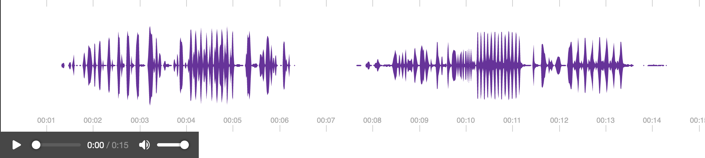

# Extension contrib

Des actions et des templates à réutiliser dans vos projets. La maintenance est
assurée par la communauté YesWiki, pas par un mainteneur attitré.

## Actions

### `{{sonogramme}}`

Visualisation interactive construite à partir d'un fichier audio.



### `{{limitentries}}`

Limite le nombre de fiches qu'un formulaire accepte.

```
{{limitentries id="1" limit="30" message_max="Il n'y a plus de places disponibles, la limite était %{limit}, désolé..." message_count="Réservation %{nb} sur %{limit}"}}
```

| Paramètre | Obligatoire | Rôle |
|---|---|---|
| `id` | oui | identifiant du formulaire |
| `limit` | oui | nombre maximum de fiches |
| `message_max` | non | message affiché une fois la limite atteinte |
| `message_count` | non | message affiché tant qu'il reste de la place |

Les deux messages acceptent `%{limit}` et `%{nb}`, remplacés par la limite et le
nombre de fiches déjà saisies.

La limite ne vaut que pour la saisie passant par cette action. L'administration de
bazar permet toujours d'ajouter des fiches au-delà.

## Templates

| Template | Rôle |
|---|---|
| `compteur_simple` | affiche uniquement le nombre de fiches trouvées |
| `photoswipe` | galerie photo |
| `kanban` | tableau kanban avec glisser-déposer |

### Paramètres du kanban

```
{{entrylist id="X" template="kanban" kanbanfield="bf_statut"}}
```

| Paramètre | Obligatoire | Rôle |
|---|---|---|
| `kanbanfield` | oui | champ servant à répartir les fiches en colonnes |
| `kanbanaddpage` | non | page wiki portant le formulaire de saisie |
| `kanbanpersonfield` | non | champ des personnes associées |
| `columns` | non | nombre de colonnes par ligne |
| `kanbancolumns` | non | valeurs des colonnes, séparées par des virgules, dans l'ordre voulu |
| `kanbancolumnslabels` | non | libellés correspondant à `kanbancolumns` |

Sans `kanbancolumnslabels`, les colonnes prennent les libellés de la liste du champ.

La galerie `photoswipe` est un modèle dynamique (`dynamic="true"`) : ses miniatures passent par le cache d'images de YesWiki.
